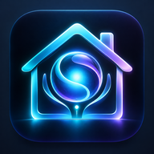
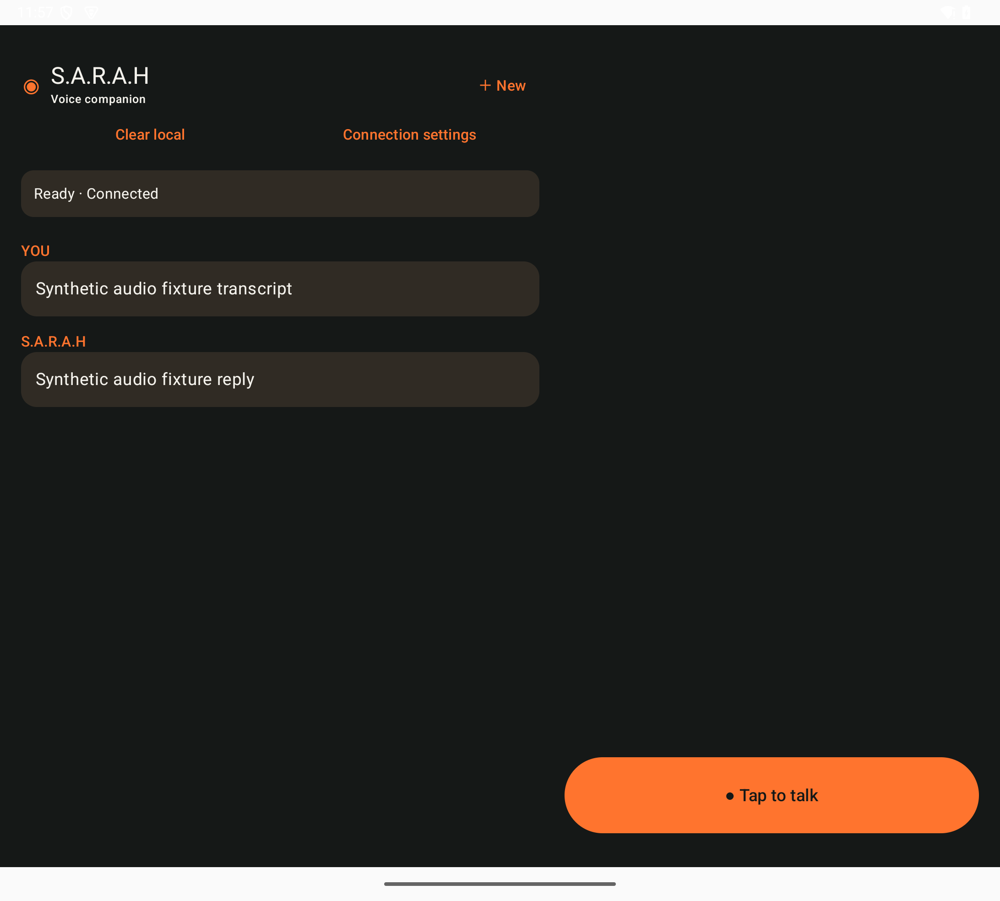
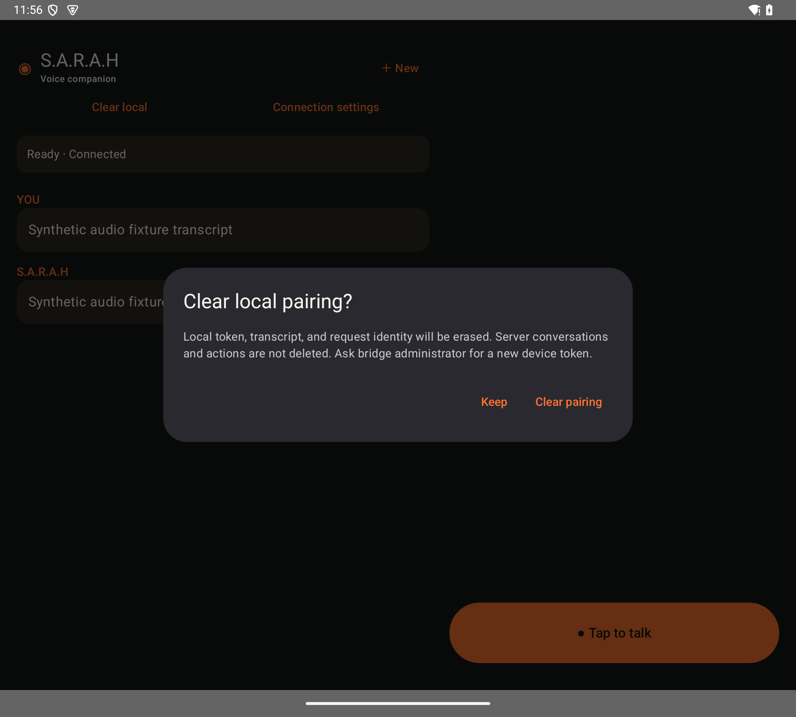

# S.A.R.A.H Android — historical code3 source

Restored historical Kotlin/Compose Android client for an HTTPS voice bridge.
This is the **pre-wake, foreground tap-to-talk** source: application ID
`com.serexe.sarah`, versionCode `3`, versionName `0.1.2-review`.
It is not the current development tree and is not a wakeword/always-listening assistant.

## Current approved icon

<p></p>

The actual launcher resource above uses the [owner-approved original artwork](artwork/launcher-artwork-original.png)
already preserved in this historical code3 source. A read-only comparison with the current development tree found the
original artwork and all 18 launcher resource files **byte-identical**. No launcher
files were replaced, and no APK was rebuilt for this documentation update.

## Screenshots — historical code3, pre-wake

These are **two authentic emulator captures of `0.1.2-review` (code3)**, not
mockups or current-development screenshots. The visible transcript and reply were
seeded synthetic fixtures, not personal conversations or evidence of a live voice
exchange. No wakeword/always-listening UI is shown.

| Foreground tap-to-talk | Local pairing confirmation |
| --- | --- |
| [](docs/screenshots/code3-tap-to-talk.png) | [](docs/screenshots/code3-clear-pairing.png) |

The second capture shows the confirmation opened by **Connection settings**;
it is not an editable connection form. The historical capture did not clear pairing.
Both images were visually reviewed for private endpoints, tokens, account IDs and
personal conversation; none were visible, so no redaction was needed.
See [screenshot provenance](docs/screenshots/PROVENANCE.md) for exact hashes and
limits. These old captures are not new runtime, phone or build verification.

## Historical artifact identity — not a reproducibility claim

The original delivered code3 APK was version `0.1.2-review`, with SHA-256:

```text
f6a493e30d6612ba96713d6543f5e7e59c98d24ec0f8472cc8bc13cb107fcc7e
```

This publication restores historical source/readbacks and preserved launcher resources.
**It has not been rebuilt, retested, analyzed, compiled, installed or run for this publication.**
No claim is made that building it produces the original signed APK bytes, or that every
undocumented historical filesystem file was recovered. Included tests are historical
source only; their presence does not mean they were run now.

The repository's **code8 release (`historical-code8`) is a separate historical artifact,
NOT generated by this source**. Existing code8 covered-source, notice and release
documents remain applicable to that separate artifact and must be retained. This source
publication does not replace or relabel existing releases, tags or APK assets.

## Signing and toolchain limitation

To preserve historical source, `app/build.gradle.kts` is unchanged. Its debug signing
configuration references `.local-review/review.jks` and `.local-review/signing-pass`.
**Those private files are intentionally absent. The historical debug-signing setup is
not portable as published and signed debug builds require a separate local signing
configuration.** The `not-configured` value is a historical missing-input placeholder,
not a usable password. Do not copy or publish the original signer or credentials.
No standard-debug-signing delta or application/runtime edit was applied.

Declared toolchain inputs: JDK 17, Android SDK 35, Android Gradle plugin 8.9.2,
Kotlin 2.0.21 and Gradle 8.11.1. The wrapper and dependency declarations are retained;
SDKs, downloaded dependencies, caches and build outputs are not bundled. Toolchain
availability and build success were not verified during publication preparation.

## Intended interaction and privacy boundaries

Historical source uses an explicit foreground tap and Android microphone permission.
It accepts a user-provided HTTPS bridge origin and a distinct revocable device token;
no bridge server or credentials are included. Stop & send uploads captured audio;
background/discard paths intend to discard capture. Local pairing state uses Android
Keystore encryption, and reply playback uses temporary app cache. These describe
source intent, not newly verified runtime or security guarantees. Reset does not
remove server history, and process death can leave temporary OS cache until eviction.
Do not pair production systems on the basis of this publication alone.

## License and retained dependencies

Owner-controlled source and owner-approved launcher artwork: MIT,
**Copyright (c) 2026 serexe**; see [LICENSE](LICENSE). This owner grant was added for
publication, not recovered from historical source.

Third-party material keeps its own licenses. Gradle wrapper retains its original
notices and bundled Apache-2.0 license; a readable copy is in
[CODE3-GRADLE-APACHE-2.0.txt](CODE3-GRADLE-APACHE-2.0.txt).
See [DEPENDENCIES.md](DEPENDENCIES.md),
[CODE3-THIRD-PARTY-NOTICES.md](CODE3-THIRD-PARTY-NOTICES.md) and
[CODE3-PUBLICATION.md](CODE3-PUBLICATION.md). This is not a transitive license clearance
or an APK distribution clearance. In particular, the historical test-only `org.json`
dependency carries the JSON.org license, not MIT.
