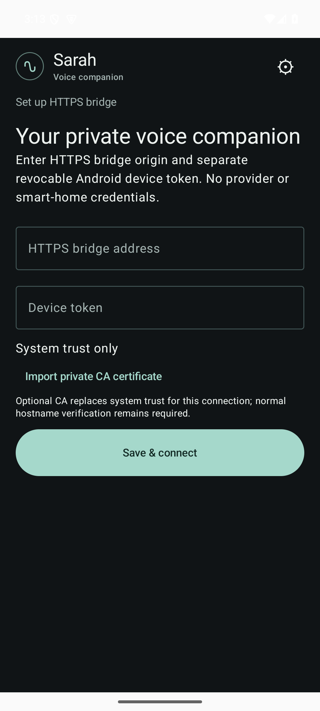
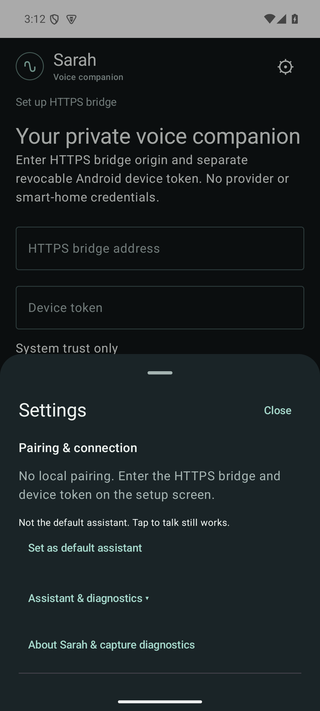

> **Moved: Sarah development now lives in [serexe/sarah-r1](https://github.com/serexe/sarah-r1).**
>
> This repository is a read-only historical archive. Use the maintained repository for [source and documentation](https://github.com/serexe/sarah-r1), [new issues](https://github.com/serexe/sarah-r1/issues), and [future releases](https://github.com/serexe/sarah-r1/releases).
>
> Existing [Android releases and APK assets](https://github.com/serexe/sarah-android/releases), Git history, branches, tags, screenshots, and provenance records remain here at their original links. They have not been copied or reissued. The historical README below describes those retained builds; consolidation does not validate a new build or establish APK/source equivalence.

# Sarah for Android

A voice companion for conversations and everyday tasks. Say **“Hey Sarah”** or tap the microphone, ask a question, hear a reply, and keep the conversation going.

Sarah connects your Android device to a **self-hosted HTTPS voice bridge**. The bridge handles transcription, AI conversation, speech generation, and any tools you choose to enable. You need your own configured backend; this is not a standalone or fully offline AI assistant.

[Download](https://github.com/serexe/sarah-android/releases/latest) · [Get started](#get-started) · [Documentation](#documentation) · [Report an issue](https://github.com/serexe/sarah-android/issues)

## What you can do

- **Talk naturally:** tap to speak, listen to spoken replies, and ask follow-up questions.
- **Use a wake word:** opt in to on-device “Hey Sarah” detection, with an Android foreground-service notification and an explicit Stop control.
- **Ask for help with your home, notes, or calendar:** connect supported tools through your backend, with only the access you configure.
- **Keep service credentials on your server:** pair the app using an HTTPS bridge address and a revocable device token, not your AI-provider or smart-home credentials.

For example, ask “Turn on the kitchen lights,” “Add milk to my notes,” or “What is on my calendar today?” These need the corresponding backend integrations and permissions; they are not connected out of the box.

## Screenshots

  
  

Actual **v31 review** APK screens: unpaired setup and Settings, not the current stable release. The paired conversation screen has not been captured. [Screenshot provenance and limits](docs/screenshots/V31-CAPTURE.md).

## Get the app

**[Download the latest stable APK](https://github.com/serexe/sarah-android/releases/latest)** for Android 8.0 or newer.

The current stable baseline is **golden30**, a local-review/debug-signed build for self-hosted setups, not a production-signed consumer release. The [v31 Command Center UI](https://github.com/serexe/sarah-android/tree/ui/command-center-review) is still a separate review branch. See the [stable baseline](SARAH_BASELINE.md) for exact APK identity and verification limits.

## Get started

1. **Run your bridge.** Follow the companion project's [bridge setup](https://github.com/serexe/sarah-r1/blob/main/docs/SETUP.md#bridge) and [configuration guide](https://github.com/serexe/sarah-r1/blob/main/docs/CONFIGURATION.md). Use its shared bridge, not its Ubuntu Touch client. See [backend details](docs/DEVELOPMENT.md#bridge-backend) for the Hermes ACP option.
2. **Install and pair Sarah.** Install the Android APK, enter your HTTPS bridge address and device token in setup, and import your CA certificate only if your bridge requires it. Keep provider and integration credentials on the server.
3. **Start talking.** Grant microphone permission and tap to speak. Enable “Hey Sarah” only if you want wake-word listening; use Stop to turn it off.

Wake-word detection runs on the device; transcription, AI replies, and speech generation depend on your backend. Screen-off successive wakes and physical-phone Stop behavior still need validation, so tap-to-talk remains the fallback. Local reset does not delete server-side history; review your bridge's permissions and data retention before connecting real accounts.

## Documentation

- [Development, build requirements, signing, and technical limits](docs/DEVELOPMENT.md)
- [Stable APK provenance and validation status](SARAH_BASELINE.md)
- [Bridge permissions and configuration](https://github.com/serexe/sarah-r1/blob/main/docs/CONFIGURATION.md) · [Bridge security](https://github.com/serexe/sarah-r1/blob/main/SECURITY.md)
- [Screenshot provenance](docs/screenshots/V31-CAPTURE.md)
- [Dependencies](DEPENDENCIES.md) · [Wake-word model and runtime](KWS-DEPENDENCIES.md)

For bugs and feature requests, [open an issue](https://github.com/serexe/sarah-android/issues). Do not include tokens, private certificates, recordings, or personal transcripts.

## License

Original project source and artwork are [MIT licensed](LICENSE). Third-party libraries and models retain their own terms; see [third-party notices](THIRD-PARTY-NOTICES.md) and [covered-source information](COVERED-SOURCE.md).
